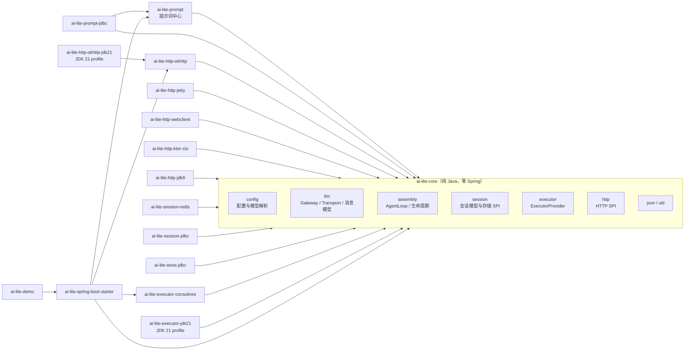
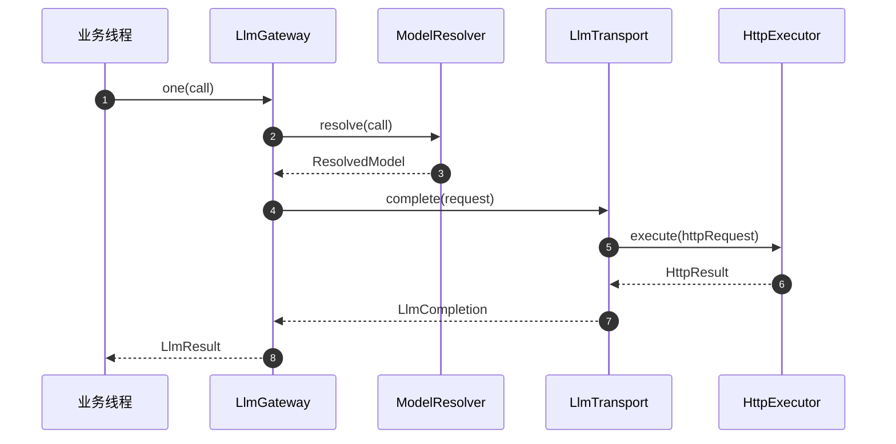
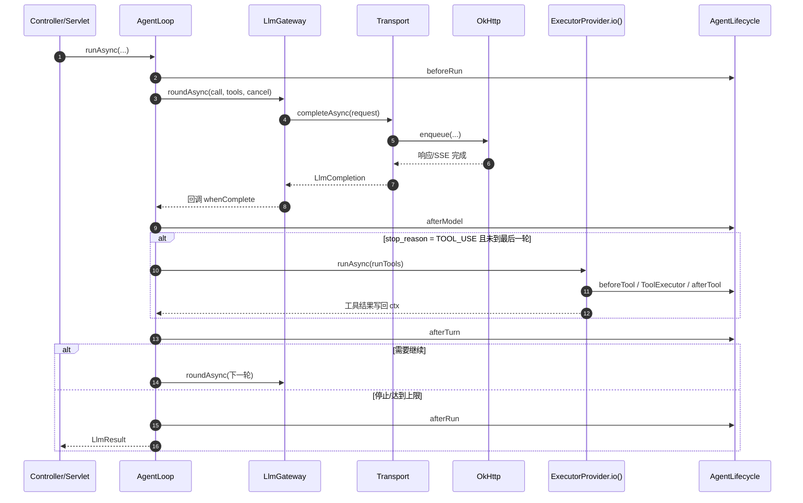
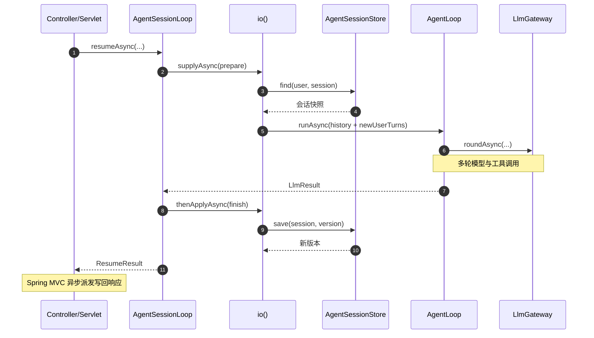
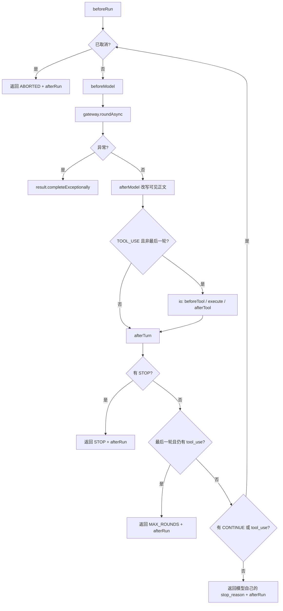

# AI Lite 架构说明

> **本文在哪一层**：全景篇（跨所有层，读一次建立地图）。
> **讲什么**：分层与模块拓扑、核心抽象、同步/异步调用链、线程与取消模型、AgentLoop 状态机、会话与提示词、扩展点——每层的**为什么**。
> **不讲什么**：每层的**怎么用**，见下面各层的专题文档。生词查 [术语表](ref-术语表.md)。

按层找文档：

| 层 | 使用（怎么用） | 原理（为什么） |
| --- | --- | --- |
| 快速入门 | [上层调用API使用指南](guide-上层调用API.md) §2 | 本文 §1–§4 |
| HTTP 传输层 | [HTTP客户端使用指南](guide-HTTP客户端.md) | [HTTP传输层原理](desc-HTTP传输.md)、[HTTP传输并发选型评估](plan/HTTP传输并发选型评估.md)（调研留档）、本文 §5 |
| 网关层 | [单次模型调用入口](desc-单次调用.md)、[重试边界](desc-重试.md) | 本文 §4–§5、[用户级线程实现说明](desc-用户级线程.md) |
| 编排层 | [Workflow异步执行器使用指南](guide-Workflow异步执行器.md) | [AgentLoop上下文说明](desc-AgentLoop上下文.md)、本文 §6 |
| 横切（配置/观测） | [配置参考](ref-配置.md) | 本文 §10–§11 |

---

## 1. 定位与约束

这个项目要解决的是：**在 Spring Boot 2.x / JDK 8 的存量系统里，用一套可替换的 SPI 接入多家 LLM，并支持工具调用、会话续聊和提示词版本管理。**

核心约束：

| 约束 | 设计后果 |
| --- | --- |
| JDK 8 字节码 | 核心模块不使用 `CompletableFuture` 之外的 JDK 9+ API；虚拟线程放在独立模块反射加载 |
| Spring Boot 2.1/2.7 | 用 `spring.factories` 注册自动装配，不用 `AutoConfiguration.imports` |
| 核心模块零框架依赖 | `ai-lite-core` 不依赖 Spring，`AiLiteConfig` 不带注解，由 Starter 绑定 |
| 存储、HTTP、并发都可替换 | 全部通过 SPI + `@ConditionalOnMissingBean` 暴露 |
| 不绑定单一模型协议 | `LlmTransport` 按 `api` 注册，请求/响应统一归一化 |

---

## 2. 模块拓扑



依赖方向始终指向 `ai-lite-core`。可选模块只通过 SPI 和自动装配接入，不反向依赖 Starter。

---

## 3. 核心抽象

| 抽象 | 位置 | 职责 |
| --- | --- | --- |
| `AiLiteConfig` | `core/config` | 纯 POJO 配置模型：业务白名单、供应商、profile、执行器、会话 |
| `ModelResolver` | `core/config` | 把 `LlmCall` 解析成 `ResolvedModel`，校验业务 id 与协议 |
| `LlmTransport` | `core/llm` | 协议适配器 SPI：同步 `complete`，可选异步 `completeAsync` |
| `HttpExecutor` / `AsyncHttpExecutor` | `core/http` | HTTP SPI：同步、流式、异步回调、异步流式 |
| `LlmGateway` | `core/llm` | 统一入口：`one` / `round` / `toolLoop` 及对应异步版本 |
| `ToolExecutor` | `core/llm` | 工具批量执行 SPI，网关的 `toolLoop` 使用 |
| `AgentLoop` | `core/assembly` | 多轮工具循环 + 7 个生命周期钩子 |
| `Workflow` / `WorkflowSpec` | `core/assembly` | 单次调用和简单工具循环的组合，不允许嵌套 AgentLoop |
| `AgentSpec` / `Assembly` | `core/assembly` | 把编排积木适配成业务输入输出对象 |
| `AgentLoopContext` | `core/assembly` | 本次循环的活消息列表、工具名单、取消句柄 |
| `AgentSessionLoop` | `core/session` | 加载会话 → 跑 `AgentLoop` → 落盘 |
| `AgentSessionStore` | `core/session` | 会话存储 SPI，带乐观版本 |
| `PromptManager` | `prompt` | 提示词草稿/发布/回滚/渲染/缓存 |
| `ExecutorProvider` | `core/executor` | 阻塞 I/O 执行器 SPI，`io()` 返回 `Executor` |

### 3.1 协议适配器

内置三个 `LlmTransport`：

- `openai-completions`
- `openai-responses`
- `anthropic-messages`

每个适配器负责：请求体序列化、SSE 解析、tool call 归一化、usage 统计、thinking 字段拆分。业务侧只看到 `LlmResult` / `LlmCompletion`，不接触协议 JSON。

`LlmMessage` 中 `text` 只放可见正文，`thinkingText` / `thinkingSignature` 独立存放。协议回传规则不同：

- OpenAI Completions 仅在 `thinking-format` 为 `deepseek` / `qwen` / `chat-template` 时回传 `reasoning_content`。
- Anthropic 只有同时存在 thinking 文本和签名时才回传 `thinking` block。
- OpenAI Responses 不回放 thinking。

详见 [desc-AgentLoop上下文.md](desc-AgentLoop上下文.md)。

### 3.2 网关的三种调用模式

| 模式 | 方法 | 行为 |
| --- | --- | --- |
| 单次模型调用入口 | `one` / `oneAsync` / `LlmCoroutines.one` / `oneAsync` | 不声明工具，发一轮 |
| 单轮工具声明 | `round` / `roundAsync` | 声明工具，只发一轮，由调用方处理工具 |
| 工具循环 | `toolLoop` / `toolLoopAsync` | 声明并执行工具，直到无 tool call 或达到轮数上限 |

流式版本为 `oneByStream` / `oneByStreamAsync` / `toolLoopByStream*`。`one` 系列的四个方法统称**「单次模型调用入口」**：同步 `one`、future `oneAsync`、Kotlin `suspend` 的 `LlmCoroutines.one`，以及作为 Java 别名的 `LlmCoroutines.oneAsync`。

异步实现是 `LlmGateway` 内部的 `AsyncRun` 状态机：每个回调只推进一轮，不在回调里阻塞等待下一轮。调用方不显式传取消句柄时，网关内部也会创建一个，因此 `future.cancel()` 能中断底层 HTTP。

### 3.3 编排组合

- `Workflow`：按顺序执行 `one` / `toolLoop` 步骤；`run(List<?>)` 遇到 `AgentLoop` 会直接拒绝，避免把多轮循环塞进单步。
- `WorkflowSpec<I,O>`：业务用实现类写一条工作流，方法内只使用传入的 `Workflow`。
- `AgentSpec<I,O>`：业务输入输出与 `AgentLoop` 的适配接口。
- `Assembly<I,O>`：几块编排积木拼装完成后对外暴露的单一入口。

这些接口都不引入框架依赖，Starter 只装配 `Workflow` 和 `AgentLoop` 两个默认 Bean，其余由业务组合。

---

## 4. 调用链

### 4.1 同步单次模型调用入口



同步路径会占住调用线程，适合批处理、定时任务或确定不需要高并发的场景。

### 4.2 异步 Agent Loop



关键点：

- 等待模型时没有业务线程被占住；HTTP 等待由 OkHttp 的 dispatcher 或自定义 `AsyncHttpExecutor` 承担。
- 工具批次提交到注入的 `ExecutorProvider.io()`，不再使用 `ForkJoinPool.commonPool()`。
- 工具逐条经过 `ToolExecutor`，以保留 `beforeTool` / `afterTool` 的顺序和拒绝语义；整批并行由网关的 `toolLoop` 或自定义 `ToolExecutor.executeAsync` 负责。
- 生命周期钩子运行在“完成当前 future 的线程”上：可能是 OkHttp 回调线程，也可能是 io 线程。需要 MDC/安全上下文时，应在钩子内部显式传递或包装执行器。

### 4.3 异步会话续聊



`resumeAsync` 在内部创建 `LlmCancelHandle`，并把返回 future 的 `cancel()` 接到句柄上。取消会穿过 `thenComposeAsync` 传到内层 `AgentLoop` 和正在进行的 HTTP 请求。

---

## 5. 线程与并发模型

### 5.1 线程角色

| 线程 | 典型来源 | 主要工作 |
| --- | --- | --- |
| 请求线程 | Tomcat / Jetty | 进入 Controller，调用 `*Async` 后释放 |
| ai-lite io 线程 | `PlatformExecutorProvider` / 虚拟线程 / 协程调度器 | 会话加载、落盘、工具执行、阻塞 SDK |
| HTTP 回调线程 | OkHttp Dispatcher / Jetty / Netty / Ktor | 完成 future，触发网关/AgentLoop 回调 |
| 协程载体线程 | `CoroutineExecutorProvider` 固定池 | 运行协程代码；协程等待时让出、恢复时回来（术语见 [术语表](ref-术语表.md) §4） |
| ai-lite 重试线程 | `RetryScheduler` 固定 2 个 daemon 线程 | `oneWithRetryAsync` 的退避结束、监听器回调、发起下一次尝试 |

`oneWithRetryAsync` 的完成回调运行在 HTTP 回调线程上，只做固定的几步分类判断和
`scheduler.schedule`（几十纳秒级，不随并发量增长）；真正的下一次尝试在 `ai-lite-retry-*` 上发起。因此 I/O 线程
不会因为退避而睡眠，重试也不会掉进 `ExecutorProvider.io()`。

异步链路的线程跳转是设计的一部分，不是偶然结果。排查问题时先确认代码运行在哪个线程上。

### 5.2 执行器

`ExecutorProvider` 只有一个方法 `io()`，它返回一个 `Executor`。理解这个接口的关键是：**它不是“模型调用执行器”，而是“阻塞副作用任务执行器”。**

#### 5.2.1 它执行什么

异步模型调用由 `CompletableFuture` 和 HTTP 回调驱动，等待响应时不占 `io()`。**但这不等于不占线程**：OkHttp 的 `enqueue` 只释放调用线程，实际 I/O、读 body 和解析仍在它的 Dispatcher 线程上执行；流式请求会占住一个 Dispatcher 线程直到流结束。提交到 `io()` 的是那些没有异步 API、只能占住线程的工作：

| 触发点 | 提交到 `io()` 的任务 | 代码位置 |
| --- | --- | --- |
| 每次模型调用记录 | 写 SLF4J 日志 + `LlmCallStore.insert(row)` 落表 | `AsyncLlmCallLogger.record` |
| Agent 循环出现 `tool_use` | `runTools`：`beforeTool`、`ToolExecutor.execute`、`afterTool`、写回 tool_result | `AgentLoop.runAsync` 工具分支 |
| 会话续聊加载 | `prepare`：`store.find`、消息转换、挂 `SessionRecorder` | `AgentSessionLoop.resumeAsync` |
| 会话续聊落盘 | `finish`：合并 recorder 结果、`store.save`、`store.find` 读回 | `AgentSessionLoop.resumeAsync` |
| 协程模式下的显式阻塞任务 | `withContext(io())` 或直接提交到 `io()` 的代码 | 业务代码 / `CoroutineExecutorProvider` |

**时序：逻辑上等工具结果，物理上不阻塞提交线程**

异步路径在 [AgentLoop.java:288](C:/dev/code_java/MavenDependency/ai-lite-spring-boot-starter/ai-lite-core/src/main/java/io/github/yinwenyuan28/ailite/assembly/AgentLoop.java#L288) 提交工具批次，并在 `toolsFuture.whenComplete` 里推进下一轮：

```text
第 N 轮模型响应完成（HTTP 回调线程）
  → afterModel、判断 toolUse
  → 把 runTools 提交到 io()，注册 whenComplete
  → return，释放 HTTP 回调线程
        │
        ▼
io 线程：runTools
  → beforeTool → ToolExecutor.execute → afterTool → 写回 tool_result
  → 整批工具完成，toolsFuture 完成
        │
        ▼
io 线程：toolsFuture.whenComplete
  → afterTurn
  → 需要继续时调用 next()，发起第 N+1 轮
```

关键点：

- **不会跳过工具结果。** `afterTurn` 和下一轮 `next()` 都挂在 `toolsFuture.whenComplete` 里；工具批次不完成就不会推进，只是提交线程不再阻塞。
- **提交的是整个 `runTools`，批内串行。** 不是每个工具一个任务；工具 A 没有执行完不会开始工具 B。
- **`direct` 模式下看起来像同步。** `runAsync` 会内联执行 `runTools` 并返回已完成的 future，`whenComplete` 也立即执行。
- **取消不中断正在跑的工具。** 工具执行期间调用 cancel，工具会继续跑完；`afterTurn` 检查 `ctx.isCancelled()` 后返回 `ABORTED`，不再发下一轮。
- **提交失败不会继续。** `io()` 拒绝任务时，future 以 `RejectedExecutionException` 异常完成，不会进入下一轮。

**不在 `io()` 上执行的工作：**

- 模型网络等待。OkHttp 用 `enqueue`，调用线程不阻塞；响应在 OkHttp Dispatcher 线程上完成 future。每个在途请求占一个 Dispatcher 线程，流式请求占至流结束；默认 `maxRequests=64`、`maxRequestsPerHost=5`。
- 协程（挂起/恢复由编译器改写实现，见 [术语表](ref-术语表.md) §4）。`coroutines` 模式下协程走 `dispatcher()`；`io()` 只是同一个载体池的阻塞视图。
- 大部分生命周期钩子。`afterModel`、`afterTurn`、`afterRun` 跑在完成 future 的线程上；`beforeRun` 和第一轮 `beforeModel` 跑在调用 `runAsync` 的线程上。只有 `runTools` 内的 `beforeTool` / `afterTool` 跟着工具任务走 `io()`。
- 网关 `toolLoop` 的默认工具执行。`ToolExecutor.executeAsync` 的默认实现是裸 `CompletableFuture.supplyAsync`，落在 `ForkJoinPool.commonPool()`；只有 `AgentLoop` 的工具路径明确使用 `io()`。走网关 `toolLoop` 且工具有阻塞时，需要自定义 `ToolExecutor.executeAsync`。
- 使用 `Jdk8HttpExecutor` 默认构造器时，HTTP 阻塞调用跑在它自己的缓存线程池；只有显式把 `io()` 传给它的构造器，才会复用这个池。默认的 OkHttp 实现不占用 `io()`。

一次异步续聊的线程归属：

```text
请求线程            controller → resumeAsync，拿到 future 后释放
io()               prepare：store.find 读会话
io()               thenCompose → AgentLoop.runAsync，发第一轮
HTTP 回调线程       第一轮完成：afterModel；有 tool_use 则提交工具
io()               runTools：beforeTool / 工具执行 / afterTool
io()               toolsFuture.whenComplete：afterTurn
HTTP 回调线程       最后一轮完成：result.complete
io()               finish：store.save + store.find
容器线程            Spring MVC 异步派发，写回 response
```

因此 `io()` 的大小应该按**阻塞并发度**估算：同时进行的工具调用 + 会话读写 + 调用记录落表。不是按 CPU 核数，也不是按同时在途的 LLM 请求数。

#### 5.2.2 四种模式

##### `platform`（默认）

- 实现：`PlatformExecutorProvider`，有界 `ThreadPoolExecutor`。
- `io()`：返回线程池本身。
- 每个阻塞任务占一个平台线程；线程数到达上限后进入队列，队列满后按拒绝策略处理。
- 默认核心线程 `max(2, CPU)`，最大线程 `max(4, CPU×2)`，队列 1000，线程名前缀 `ai-lite-`，拒绝策略 `abort`。
- 优点：JDK 8 可用、无额外依赖、行为可预测。
- 代价：并发上限就是线程数；数千个同时阻塞的任务需要数千个线程。

适合：JDK 8、并发量中等、阻塞任务不会长时间挂起的通用场景。

##### `direct`

- 实现：`DirectExecutorProvider`，`io()` 返回一个直接执行 `command.run()` 的 Executor。
- 不切线程、不建池、没有拒绝策略。
- 好处：零线程切换、行为确定、测试容易复现。
- 代价：所有本应异步的阻塞工作都压回调用线程。`resumeAsync` 的 `prepare`、`finish` 和工具执行会同步跑完；只有模型等待仍可能由 OkHttp 异步完成。
- 注意：`direct` 不等于整个调用变成同步。`gateway.oneAsync` 仍然走异步 transport；只是提交到 `io()` 的任务不再换线程。

适合：单元测试、单线程环境、确定任务很短且不需要并发的场景。

##### `virtual`（JDK 21）

- 实现：`VirtualThreadExecutorProvider`，`Executors.newVirtualThreadPerTaskExecutor()`。
- `io()`：每个提交的任务创建一个虚拟线程，不做池化。
- 虚拟线程阻塞在 socket、sleep、队列等可挂起操作时会从载体线程卸载，少量载体线程可以承载大量阻塞任务。
- 要求 JDK 21 运行时 + `ai-lite-executor-jdk21` 模块；Starter 通过反射加载，JDK 8 运行时不会解析虚拟线程类。
- 注意 pinning：JDK 21–23 在 `synchronized` 块或 native 帧里阻塞会钉住载体线程；JDBC 驱动是否卸载取决于其内部实现。JDK 24 的 JEP 491 已大幅缓解。
- 它只改变阻塞任务跑在哪里，不会把同步 `gateway.one()` 变成异步。
- 配置里的 `core-size`、`max-size`、`queue-capacity`、`keep-alive-seconds`、`rejection-policy` 在这个模式下都不生效。

适合：JDK 21、工具或老 SDK 是阻塞式、又不想把业务改写成 `suspend` 的系统。

##### `coroutines`（Kotlin）

- 实现：`CoroutineExecutorProvider`，固定大小的载体线程池。
- `dispatcher()`：给协程续体使用；`io()`：同一个载体池的 `Executor` 视图。
- 真正的用户级并发来自 `suspend` + `LlmCoroutines.one/round/toolLoop`：等待 future 时协程挂起，载体线程去跑别的协程。
- 协程是无栈的（编译器 CPS 变换），必须显式 `suspend`；在协程里直接调用阻塞 JDBC/工具而不 `withContext(io())`，会把载体线程占住。
- `io()` 返回的仍然是会阻塞的载体池，只适合短任务；长时间阻塞任务放进去会拖垮所有协程。
- 要求 `ai-lite-executor-coroutines` + Kotlin 运行时；和 Java 在同一个 JVM，不存在两个 JVM。
- 通过 Starter 配置时，`core-size` 决定载体线程数（默认 `max(2, CPU)`）；直接 `new CoroutineExecutorProvider()` 的默认值是 `max(4, CPU×2)`。`max-size`、`queue-capacity`、`keep-alive-seconds`、`rejection-policy` 不生效。
- 它只替换执行器。要真正获得挂起能力，业务要调用 `LlmCoroutines` 或 `dispatcher()`；如果只用 Java 的 `*Async` API，`mode=coroutines` 和 `platform` 的区别主要是“用哪个池跑阻塞任务”。

适合：JDK 8 + Kotlin、LLM 等待占主导、希望用顺序写法表达多步调用并保留结构化取消的团队。

#### 5.2.3 横向对比

| 维度 | platform | direct | virtual | coroutines |
| --- | --- | --- | --- | --- |
| 线程模型 | 有界平台线程池 | 调用线程内联 | 每任务一个虚拟线程 | 固定载体池 + 协程挂起 |
| 阻塞等待时是否占线程 | 是，占一个平台线程 | 是，占调用线程 | 通常卸载，不占载体 | 协程挂起后不占载体 |
| 并发上限 | 最大线程数 + 队列 | 无并发，串行 | 受内存和下游连接池限制 | 受载体数和下游连接池限制 |
| 阻塞工具/JDBC | 直接占线程 | 阻塞调用方 | 较友好，注意 pinning | 必须 `withContext(io())`，否则占载体 |
| 取消 | `LlmCancelHandle` | 同左 | 同左 | 同左，另有 `Job` 结构化取消 |
| 额外依赖 | 无 | 无 | JDK 21 + 模块 | Kotlin + 模块 |
| 主要风险 | 队列拒绝、线程多 | 调用线程被阻塞 | synchronized/native pinning | 阻塞任务饿死载体、`io()` 队列无界 |
| 典型场景 | JDK 8 通用 | 测试 | JDK 21 + 阻塞 SDK | JDK 8 + Kotlin + 高并发等待 |

参考数据（3000 次调用、50ms 延迟、8 载体）：协程路径约 3.4 万 QPS、26 个线程；1000 线程池约 1.5 万 QPS、1017 个线程；纯 Java 异步约 4.2 万 QPS、18 个线程。这组数据说明的是“等待模型时是否占线程”，不是四种执行器模式的直接排名。详见 [desc-用户级线程.md](desc-用户级线程.md)。

#### 5.2.4 配置字段与生效范围

| 字段 | 默认值 | 生效模式 | 说明 |
| --- | --- | --- | --- |
| `mode` | `platform` | 全部 | `platform` / `direct` / `virtual` / `coroutines` |
| `core-size` | `max(2, CPU)` | platform、coroutines | platform 的核心线程数；coroutines 通过 Starter 时的载体线程数 |
| `max-size` | `max(4, CPU×2)` | platform | 最大线程数 |
| `queue-capacity` | `1000` | platform | 有界队列容量 |
| `keep-alive-seconds` | `60` | platform | 空闲线程存活时间 |
| `thread-name-prefix` | `ai-lite-` | platform、coroutines | coroutines 模式会在后面追加 `coroutine-` |
| `rejection-policy` | `abort` | platform | `abort` 或 `caller-runs` |

补充：

- `direct` 不建池，所有池字段都被忽略。
- `virtual` 每个任务一个虚拟线程，所有池字段都被忽略。
- `coroutines` 使用固定池，队列无界；`max-size`、`queue-capacity`、`keep-alive-seconds`、`rejection-policy` 都不生效。
- Starter 把 `ExecutorProvider` 注册为 `destroyMethod="close"` 的 Bean，容器关闭时会释放线程；手动创建时需要自己调用 `close()`。

#### 5.2.5 选择建议与常见误区

选择建议：

- JDK 8、Java 为主、阻塞任务量中等：`platform`。
- 单元测试、需要确定性时序：`direct`。
- JDK 21、工具/老 SDK/JDBC 是阻塞式：`virtual`。
- JDK 8 + Kotlin、LLM 等待占主导、希望顺序写法：`coroutines`，并且业务实际调用 `LlmCoroutines`。
- 如果阻塞工作很少、主要是等模型：`platform` 就够了；异步网关本来就不为等待占线程，换执行器不会显著提升模型 QPS。

常见误区：

1. **“换 virtual/coroutines 会让模型 QPS 更高。”** 不会。纯模型等待不占调用线程；传输层仍按 HTTP 客户端模型占线程（OkHttp 占 Dispatcher 线程），执行器只影响阻塞副作用任务。
2. **“`mode=virtual` 会让同步 API 变成异步。”** 不会，它只替换 `io()` 的实现。
3. **“协程模式下所有代码都自动挂起。”** 不会，只有 `suspend` 函数在挂起点让出载体；阻塞调用照样占线程。
4. **“`direct` 适合生产高并发。”** 不适合，它会把本该并行的阻塞工作串行压到调用线程上。
5. **“协程的 `io()` 可以随便跑长阻塞任务。”** 不可以，`io()` 和 `dispatcher()` 共用载体池，长阻塞会饿死其他协程。
6. **“队列满了只是变慢。”** `platform` 默认 `abort`，队列满会拒绝会话加载/落盘；异步调用日志是特例，它会吞掉拒绝并打 warn，不影响主调用。

`AgentLoop` 和 `AgentSessionLoop` 默认复用网关的执行器，也可以构造时显式传入。Starter 的 Bean 方法会显式注入同一个 `ExecutorProvider`，保证 Spring 环境下行为一致。

### 5.3 取消链

```text
future.cancel(true)
  └─ LlmCancelHandle.cancel()
       └─ 传输层绑定的 abort
            └─ OkHttp Call.cancel() / 关闭流
```

- `LlmCancelHandle` 是协作式取消：绑定前取消会在 `bindAbort` 时立即执行；`cancel()` 与 `bindAbort()` 的任意交错下，abort 最多执行一次。一个句柄只服务一次调用，第一次 abort 后不复位。
- L1（真正打断在途 HTTP）取决于传输层：OkHttp 的 `Call.cancel()` 全阶段有效；JDK 8 `HttpURLConnection` 在正文/SSE 阻塞读阶段可能等到读超时。对取消时延敏感的同步调用应使用 OkHttp 传输。
- `LlmGateway.invokeAsync`、`AgentLoop.runAsync`、`AgentSessionLoop.resumeAsync` 都会在没有外部句柄时创建内部句柄。
- 取消是协作式的：工具或自定义传输如果忽略中断，底层工作可能继续；网关会在正常完成前再检查一次取消状态，保证结果不会越过取消变成正常完成。

完整的入口清单、L1–L4 语义和错误分类见 [单次模型调用入口](desc-单次调用.md)。

### 5.4 协程桥接

`ai-lite-executor-coroutines` 提供：

- `CoroutineExecutorProvider`：固定载体池，`dispatcher()` 给协程，`io()` 给阻塞任务。
- `LlmCoroutines.one/round/toolLoop`：`suspend` 包装，内部是 `gateway.*Async(...).await()`。其中 `LlmCoroutines.one` 是单次模型调用入口的 Kotlin 形式，`LlmCoroutines.oneAsync` 是它的 Java future 别名。

Kotlin 编译成 JVM 字节码，和 Java 代码运行在同一个 JVM，不存在“两个 JVM”。协程只改变等待时的线程占用方式，不改变网络协议和网关语义。

### 5.5 线程池总清单

排查线程问题、评审容量时用这节对号入座。**框架自己创建的线程池只有 3 个**（`io()` 池、重试调度器、回调池），JDK8 传输自己带 1 个；其余线程都属于 HTTP 客户端库或调用方。

| 线程名（jstack 里长这样） | 谁创建 | 默认规模 | 只干什么 | 绝不干什么 | 在哪配 |
| --- | --- | --- | --- | --- | --- |
| （调用线程）Tomcat worker 等 | 调用方 | — | 同步入口的整条链路；异步入口只做校验、解析、递交后返回 | —— | 业务方 |
| OkHttp Dispatcher | OkHttp 客户端 | 64，每主机 5 | socket I/O、响应解析、完成回调、inline 的 onDelta | 退避等待、慢回调（拖垮全部在途请求） | `ai-lite.http.dispatcher.*` |
| `ai-lite-jdk8-http-N` | Jdk8HttpExecutor | cached 池（daemon） | 仅 jdk8 传输的异步 I/O | —— | （无配置键） |
| Jetty selector / reactor-nio / ktor 内部线程 | 各 HTTP 客户端 | 各自默认 | 同 OkHttp 行 | 同 OkHttp 行 | `ai-lite.http.jetty.*` / `ktor.*` |
| `ai-lite-N`（io 池） | ExecutorProvider（platform 模式） | core=max(2,CPU)、max=max(4,2×CPU)、queue=1000 | 调用记录落盘、工具执行、会话加载/落盘、阻塞 SDK、出口保护排队许可交接后的续跑 | 模型网络等待；长阻塞任务 | `ai-lite.executor.*` |
| `ai-lite-coroutine-N`（载体线程） | CoroutineExecutorProvider（coroutines 模式） | max(2,CPU)（经 Starter） | 跑协程代码；协程挂起时让出去跑别的 | 任何长阻塞（占住即饿死全部协程） | `ai-lite.executor.core-size` |
| （虚拟线程） | JDK 21（virtual 模式）/ okhttp-virtual | 每任务一个 | virtual 模式的阻塞任务；okhttp-virtual 的传输回调 | —— | `ai-lite.executor.mode` / `ai-lite.http.transport` |
| `ai-lite-retry-N` | RetryScheduler | 固定 2（daemon） | `oneWithRetryAsync` 的退避计时、发起下一次尝试、notifyRetry 监听器、出口保护的排队超时定时器 | 慢监听器（它只有 2 条线程，是全局单点） | Bean 名 `aiLiteRetryScheduler` 覆盖 |
| `ai-lite-callback-N` | CallbackPolicy（io 模式） | core 2 / max 8 / queue 2048 | io 模式的 onDelta、完成事件、Agent 钩子——每个调用独享一个串行队列，按序执行 | 长活（慢回调只阻塞自己的调用，但占池子） | `ai-lite.callback.*` |

三条使用纪律：

- **排队不占线程。** 出口保护排队的异步调用、等待退避的重试调用，在队列里都只是一个小对象，没有任何线程为它们空转；轮到时才有人出站（io 池接力）或定时器叫人（retry 池）。
- **回调线程快进快出。** OkHttp Dispatcher 和 `ai-lite-callback-*` 都是多调用共享的：在上面做阻塞操作（写库、同步下游、长计算）会拖慢所有调用。onDelta 想做重活就切 `ai-lite.callback.mode=io`。
- **推进复用，不新建池。** AgentLoop 的推进循环、Workflow 主循环都在完成回调线程上推进；调用记录落盘走 `io()` 池；出口保护的定时器委托给 retry 调度器——没有第 4 个框架池。

同步/异步一次调用在这些线程之间怎么接力，见 [单次模型调用入口](desc-单次调用.md) §2–§5；执行器四种模式（platform / direct / virtual / coroutines）的选择见 §5.2。

---

## 6. AgentLoop 状态机



决策规则：

- **工具拒绝是 deny-wins**：任意钩子拒绝，本次调用不执行，拒绝原因作为 tool result 进入下一轮。
- **停止是 stop-wins**：任意钩子返回 STOP 就停止。
- 没人 STOP、有人 CONTINUE 时再来一轮。
- 达到 `maxRounds` 且模型仍要求工具时返回 `MAX_ROUNDS`。
- 取消返回 `ABORTED`；异常通过 future 的 `completeExceptionally` 表达，不再向异步调用方同步抛出。
- 异步状态机把 `next()` 和 `advance()` 分开：`next()` 捕获回调里逃逸的 `RuntimeException`，避免 future 永久不完成。

生命周期钩子的完整语义见 `AgentLifecycle` 的 Javadoc。

---

## 7. 出站上下文

每一轮发给模型的消息由以下部分组成：

1. 调用方传入的 system / user 消息；
2. 会话历史（续聊时）；
3. 本次循环内模型返回的 assistant 消息（含 tool calls）；
4. 工具执行结果（`tool_result`）；
5. `beforeModel` 钩子对消息和工具名单的修改。

`text` 与 `thinkingText` 是独立字段。同一轮工具循环内，assistant 消息会把 thinking 一起带回下一轮（协议支持时）。跨 `resume` 的会话历史默认 `includeThinking=false`，即持久化的 thinking 不重新发送；需要时调用 `AgentSession.toLlmMessages(true)`。

图片、协议细节和上下文增长示例见 [desc-AgentLoop上下文.md](desc-AgentLoop上下文.md)。

---

## 8. 会话与持久化

### 8.1 模型

- `AgentSession`：`userId + sessionId` 唯一，`version` 为乐观锁版本。
- `AgentSessionMessage`：稳定 `id`、role、可见正文、thinking、tool calls、tool call id。
- `AgentSessionCodec`：会话快照的编解码，兼容可选 thinking 字段。

### 8.2 续聊流程

```text
prepare:
  find(user, session)
  + newUserTurns
  -> 校验 message id 唯一
  -> 转成 LlmMessage
  -> 追加内置 SessionRecorder

run:
  AgentLoop.runAsync(...)

finish:
  ABORTED -> 直接返回旧快照，不落盘
  其他    -> recorder 结果合并进 pending
          -> save(version)
          -> find 读回新快照
```

- 取消或异常不会落半截：`finish` 只在循环正常结束时执行。
- `save` 使用版本条件更新；同一会话并发续聊会抛“会话版本冲突”，由调用方决定重试还是让用户重发。
- `SessionRecorder` 把每轮 assistant 与 tool result 转成会话消息；前面 hook 拒绝工具时，它会在 `afterTurn` 从 `ctx` 补齐缺失的 tool result。

### 8.3 存储实现

| 模块 | 能力 |
| --- | --- |
| `InMemoryAgentSessionStore` | 有界、带 TTL，默认实现 |
| `CachingAgentSessionStore` | 持久层 + `SessionCache`，缓存不承担版本校验 |
| `ai-lite-session-redis` | Redis 快照缓存，坏 JSON 按 miss 处理 |
| `ai-lite-session-jdbc` | `JdbcTemplate` 持久化，版本条件更新，表名可配置 |

JDBC 自动装配在 `JdbcTemplateAutoConfiguration` 之后、`AiLiteSessionAutoConfiguration` 之前，保证存在 `JdbcTemplate` 时替换默认内存存储。

---

## 9. 提示词中心

`ai-lite-prompt` 是独立的纯 Java 模块：

- `PromptKey`：key、标题、占位符、默认模板。
- `PromptVersion`：版本号、状态、系统/用户模板、hash。
- `PromptStore`：存储 SPI；`InMemoryPromptStore` 用于单机/测试。
- `PromptManager`：草稿、修改、发布、回滚、审计、渲染、缓存失效。

语义：

- 只有草稿可以修改和发布；只有发布过的版本可以回滚。
- 发布前校验模板中的占位符。
- 生效版本带短 TTL 缓存；发布/回滚立即失效本节点缓存，多节点最多等一个 TTL。
- 存储不可用时 `current` 返回空、`render` 回退默认模板，不阻断业务。
- `ai-lite-prompt-jdbc` 在传入 `PlatformTransactionManager` 时把“退役旧版本、发布新版本、更新生效指针”放在一个事务里。

---

## 10. 自动装配

`ai-lite-spring-boot-starter` 通过 `spring.factories` 注册三个配置：

- `AiLiteAutoConfiguration`：配置、执行器、HTTP、Transport、Gateway、Workflow、AgentLoop。
- `AiLiteSessionAutoConfiguration`：会话存储与 `AgentSessionLoop`。
- `AiLitePromptAutoConfiguration`：提示词目录、存储、管理器。

开关：

| 属性 | 作用 |
| --- | --- |
| `ai-lite.enabled=false` | 关闭全部 Starter Bean |
| `ai-lite.session.enabled=false` | 只关闭会话层 |
| `ai-lite.prompt.enabled=false` | 只关闭提示词层 |

覆盖方式：所有 Bean 都有 `@ConditionalOnMissingBean`，业务可以自己声明同类型 Bean 替换。Boot 2.1 不支持重复的 `@ConditionalOnProperty`，提示词层用嵌套配置类处理组合条件。

---

## 11. 可观测性与错误处理

- 每次模型调用记录一行 `LlmCallRecord`：bizId、provider、model、api、轮次、tokens、延迟、stop reason、成功标记、错误摘要。
- `AsyncLlmCallLogger` 把写日志和落表提交到 `ExecutorProvider.io()`，存储故障或线程池拒绝不会影响主调用；错误摘要会遮蔽 api key。
- 未登记 bizId、协议不支持、配置缺失等在发请求前抛 `LlmCallException`。
- 工具不存在、参数非法 JSON、工具执行异常都转成文本回给模型，不中断循环。
- 异步路径的异常统一通过 future 表达；调用方应使用带超时的 `get`/`join` 或 `whenComplete`。

---

## 12. 扩展点

| SPI | 默认实现 | 替换方式 |
| --- | --- | --- |
| `LlmTransport` | 三个内置协议 | 实现 `api()` + `complete`，注册为 Bean |
| `HttpExecutor` | OkHttp / OkHttp-Virtual / Jetty / JDK8 | 实现同步接口；需要异步回调时同时实现 `AsyncHttpExecutor`。Starter 按 `ai-lite.http.transport` 选择 |
| `ToolExecutor` | `SequentialToolExecutor` | 实现批量执行；必须保证结果顺序与入参一致 |
| `ExecutorProvider` | Platform / Direct / Virtual / Coroutines | 实现 `io()`，交给 Starter 或手动注入 |
| `AgentSessionStore` | InMemory / JDBC | 实现 `find/save/delete/exists` |
| `SessionCache` | Redis | 实现快照读写 |
| `PromptStore` | InMemory / JDBC | `activate` 必须原子完成三步切换 |
| `LlmCallStore` | Noop / JDBC | 实现调用记录落表 |

---

## 13. 测试策略

当前全量 570 个用例（Redis 不可用时其中 1 个集成测试类跳过），覆盖：

- 网关同步/异步/流式、取消、错误包装、工具循环。
- AgentLoop 的生命周期顺序、拒绝/停止共识、多轮工具、取消、回调异常出口。
- AgentSessionLoop 的加载/落盘/取消/线程选择/版本冲突。
- 三个协议适配器的请求序列化、SSE 解析、thinking 回传。
- 提示词版本流转、JDBC 存储、事务与占位符校验。
- Starter 自动装配、条件开关、装配顺序。
- 协程桥接：单线程调度器上 2000 个 suspend 调用、取消与错误传播。

对抗性用例设计见 [docs/testing/测试索引.md](testing/测试索引.md)，按 AgentLoop、会话层、网关三块拆分，共 103 个用例（P0 29 个），并标注了现有覆盖和建议实现顺序。单次模型调用入口相关共 72 个用例（入口/取消/边界 45 个 + 图片 27 个），见同文档「已实现」一节。

异步测试必须带超时断言（例如 `future.get(5, TimeUnit.SECONDS)`），避免回归时把测试进程挂死。

---

## 14. 设计取舍与已知边界

- **异步编排用 `CompletableFuture` 状态机，而不是协程。** 好处是核心模块保持 JDK 8 + 零 Kotlin 依赖；代价是控制流反转、状态字段手写维护。协程版本是可选门面，不是替代品。
- **工具在 AgentLoop 里逐条执行。** 这样 `beforeTool` / `afterTool` 的顺序和拒绝语义明确；整批并行留给网关的 `toolLoop`。如果业务需要并行且能接受逐条回调，可以自定义 `ToolExecutor`。
- **生命周期钩子运行在完成线程上。** 目前不做 MDC/安全上下文的自动传播；需要时在钩子内部显式传递，或包装执行器。
- **会话落盘与模型调用不在同一个事务里。** 模型已经产生费用后，落盘失败只能由调用方重试；`finish` 中 save 成功但读回失败属于部分成功，调用方需要按业务决定是否重试。
- **跨轮 thinking 默认不回放。** 同一轮工具循环内会回放；跨 `resume` 默认丢弃，避免不兼容协议和额外 token。
- **JDK 8 下没有原生虚拟线程。** `virtual` 模式需要 JDK 21 运行时；`coroutines` 模式需要 Kotlin 依赖。两者都是可选模块。
- **默认 `LlmTransport.completeAsync` 仍可能落到 commonPool。** 内置完整传输会覆盖为异步回调路径；调用线程不阻塞，但 OkHttp 仍在 Dispatcher 线程执行 I/O。自定义传输如果只有阻塞实现，应自己覆盖 `completeAsync` 或改用 `AsyncHttpExecutor`，并明确它占哪类线程。

---

## 15. 关键文件地图

| 主题 | 文件 |
| --- | --- |
| 配置与模型解析 | `ai-lite-core/src/main/java/io/github/yinwenyuan28/ailite/config/` |
| 网关 | `ai-lite-core/src/main/java/io/github/yinwenyuan28/ailite/llm/LlmGateway.java` |
| 消息与结果 | `ai-lite-core/src/main/java/io/github/yinwenyuan28/ailite/llm/LlmMessage.java`、`LlmResult.java`、`LlmCompletion.java` |
| 协议适配器 | `ai-lite-core/src/main/java/io/github/yinwenyuan28/ailite/transport/` |
| Agent 循环 | `ai-lite-core/src/main/java/io/github/yinwenyuan28/ailite/assembly/AgentLoop.java` |
| 编排组合 | `ai-lite-core/src/main/java/io/github/yinwenyuan28/ailite/assembly/Workflow.java`、`WorkflowSpec.java`、`AgentSpec.java`、`Assembly.java` |
| 生命周期 | `ai-lite-core/src/main/java/io/github/yinwenyuan28/ailite/assembly/AgentLifecycle.java` |
| 会话续聊 | `ai-lite-core/src/main/java/io/github/yinwenyuan28/ailite/session/AgentSessionLoop.java` |
| 会话模型 | `ai-lite-core/src/main/java/io/github/yinwenyuan28/ailite/session/AgentSession.java`、`AgentSessionMessage.java` |
| 执行器 | `ai-lite-core/src/main/java/io/github/yinwenyuan28/ailite/executor/` |
| 提示词中心 | `ai-lite-prompt/src/main/java/io/github/yinwenyuan28/ailite/prompt/` |
| 自动装配 | `ai-lite-spring-boot-starter/src/main/java/io/github/yinwenyuan28/ailite/autoconfigure/` |
| 协程桥接 | `ai-lite-executor-coroutines/src/main/kotlin/io/github/yinwenyuan28/ailite/executor/coroutines/` |
| 基准 | `benchmark/qps-benchmark/` |
