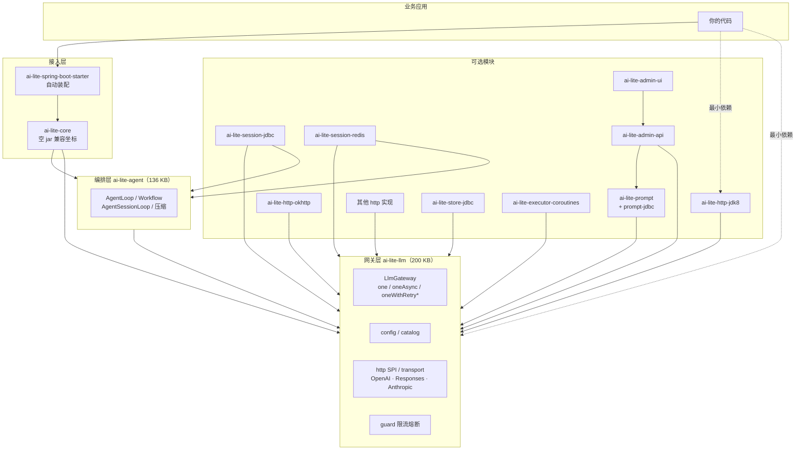

# 模块依赖关系图

> **本文档在哪一层**：速查（拉一份整体地图）。
> **讲什么**：拆分后各 Maven 模块的依赖方向、jar 体积、单次调用的最小依赖集合。
> **不讲什么**：各模块内部实现，见 [架构说明](desc-架构总览.md)。

---

## 1. 一句话结论

```text
ai-lite-core  =  ai-lite-llm（网关）+ ai-lite-agent（编排/会话）
```

`ai-lite-core` 自 0.1.8 起只是**兼容坐标**，本身不含源码，只把两个模块的依赖传递出去。
单次调用只需要 `ai-lite-llm` + 一个 HTTP 实现，**不需要 `ai-lite-agent`**。

---

## 2. 分层拓扑



**依赖方向永远指向 `ai-lite-llm`**，没有任何模块反向依赖 `ai-lite-agent`，更没有模块依赖 `ai-lite-core`（除了 starter 用它做聚合）。

---

## 3. 各模块直接依赖表

数据取自各模块 `pom.xml`（2026-10-28）。

| 模块 | 直接依赖的内部模块 | 说明 |
| --- | --- | --- |
| `ai-lite-llm` | — | 根模块，只依赖 slf4j + jackson |
| `ai-lite-agent` | `ai-lite-llm` | 编排与会话 |
| `ai-lite-core` | `ai-lite-llm`、`ai-lite-agent` | **空 jar**，仅传递 |
| `ai-lite-prompt` | `ai-lite-llm` | 提示词中心 |
| `ai-lite-prompt-jdbc` | `ai-lite-prompt` | |
| `ai-lite-store-jdbc` | `ai-lite-llm` | 调用记录落表 |
| `ai-lite-http-okhttp` | `ai-lite-llm` | 默认 HTTP |
| `ai-lite-http-jdk8` | `ai-lite-llm` | 零第三方依赖 HTTP |
| `ai-lite-http-jetty` | `ai-lite-llm` | |
| `ai-lite-http-webclient` | `ai-lite-llm` | |
| `ai-lite-http-ktor-cio` | `ai-lite-llm` | Kotlin |
| `ai-lite-http-okhttp-jdk21` | `ai-lite-http-okhttp` | JDK 21 profile |
| `ai-lite-executor-coroutines` | `ai-lite-llm` | Kotlin 协程桥接 |
| `ai-lite-executor-jdk21` | `ai-lite-llm` | 虚拟线程，JDK 21 profile |
| `ai-lite-session-jdbc` | `ai-lite-llm`、`ai-lite-agent` | 会话存储 |
| `ai-lite-session-redis` | `ai-lite-llm`、`ai-lite-agent` | 会话缓存 |
| `ai-lite-admin-api` | `ai-lite-llm`、`ai-lite-prompt` | 运行时目录 + REST |
| `ai-lite-admin-ui` | `ai-lite-admin-api` | 自带管理页 |
| `ai-lite-spring-boot-starter` | `ai-lite-core`、prompt、okhttp、coroutines、session-jdbc、admin-api 等 | 聚合装配 |
| `ai-lite-demo` | starter、admin-api、admin-ui、prompt-jdbc、store-jdbc | 示例 |

---

## 4. 单次调用的最小依赖

### 4.1 Maven 坐标

```xml
<dependency>
  <groupId>io.github.yinwenyuan28-afk</groupId>
  <artifactId>ai-lite-llm</artifactId>
  <version>0.1.8</version>
</dependency>
<dependency>
  <groupId>io.github.yinwenyuan28-afk</groupId>
  <artifactId>ai-lite-http-jdk8</artifactId>
  <version>0.1.8</version>
</dependency>
```

### 4.2 实际传递依赖树

```text
ai-lite-llm
  +- org.slf4j:slf4j-api
  \- com.fasterxml.jackson.core:jackson-databind
       +- com.fasterxml.jackson.core:jackson-annotations
       \- com.fasterxml.jackson.core:jackson-core
ai-lite-http-jdk8
  (无第三方依赖)
```

**4 个第三方 jar，没有 `ai-lite-agent`，没有 `ai-lite-core`。**
`ai-lite-http-jdk8` 基于 `HttpURLConnection`，所以不会像 OkHttp 那样带入 `okhttp` + `kotlin-stdlib`。

### 4.3 可用入口

```java
LlmGateway gateway = new LlmGateway(resolver, transports, store, executor, toolExecutor);

gateway.one(call);                    // 同步一次
gateway.one(call, cancel);            // 同步 + 取消句柄
gateway.oneWithRetry(call, policy);   // 同步 + 重试
gateway.oneAsync(call);               // 异步一次
gateway.oneWithRetryAsync(call, policy); // 异步 + 重试
```

这四个方法构成「单次模型调用入口」，全部在 `ai-lite-llm` 内，不触达 `ai-lite-agent`。

---

## 5. 升级路径：从最小依赖到完整能力

按需加模块，不需要改动已有代码：

| 想要的能力 | 加这个模块 | 带来的额外体积 |
| --- | --- | --- |
| 工具循环 / 多轮 Agent | `ai-lite-agent` | 136 KB |
| 会话续聊与持久化 | `ai-lite-agent` + `ai-lite-session-jdbc`（或 `-redis`） | 136 KB + 存储模块 |
| 提示词版本管理 | `ai-lite-prompt`（+ `-jdbc`） | 小 |
| 调用记录落表 | `ai-lite-store-jdbc` | 小 |
| 高性能 HTTP | 换成 `ai-lite-http-okhttp` | okhttp 772 KB + kotlin-stdlib 1.7 MB |
| 虚拟线程 / 协程 | `ai-lite-executor-jdk21` / `ai-lite-executor-coroutines` | 小（但需 JDK 21 / Kotlin 运行时） |
| 少写装配代码 | `ai-lite-spring-boot-starter` | 引入 Spring Boot 自动装配与全部默认实现 |

---

## 6. 包级分层（源码视角）

即使两个模块都在 `io.github.yinwenyuan28.ailite` 下，**包集合完全不重叠**：

```text
ai-lite-llm                      ai-lite-agent
├── llm/                         ├── assembly/
├── config/                      ├── session/
├── catalog/                     └── internal/
├── guard/                           ├── assembly/
├── transport/                       └── session/
├── http/
├── json/
├── util/
├── executor/
└── internal/
    ├── llm/
    ├── executor/
    └── http/
```

依赖方向在源码层同样单向：

```text
ai-lite-agent  ──依赖──>  ai-lite-llm
（assembly / session 引用 llm / config / util）
```

反向引用经逐 import 校验为 **0 处**，因此两个模块可以独立编译、独立发布。

---

## 7. jar 体积对照

| 模块 | 体积 | 内容 |
| --- | --- | --- |
| `ai-lite-core`（拆分前） | 324 KB | 全部：网关 + 编排 + 会话 |
| `ai-lite-llm` | 200 KB | 网关 + 协议 + HTTP SPI + 配置 |
| `ai-lite-agent` | 136 KB | 编排 + 会话 |
| `ai-lite-core`（拆分后） | 4 KB | 空 jar，仅 POM 元数据 |

源码行数：16,434 行拆分为 `ai-lite-llm` 9,451 行 + `ai-lite-agent` 6,983 行。
**只做单次调用的项目不再需要拖入编排和会话代码。**

---

## 8. 相关文档

- 拆分决策与实施记录：[拆分最小依赖计划](plan/拆分最小依赖-ai-lite-llm-plan.md)
- 架构与线程模型：[架构说明](desc-架构总览.md)
- 单次调用入口详解：[单次模型调用入口](desc-单次调用.md)
